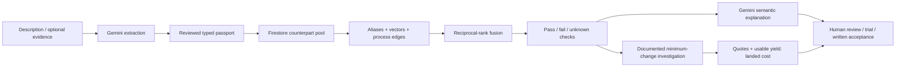

# WasteRecast global exchange — acceptance methodology v2

Live: https://wasterecast.web.app/#exchange

## Implemented workflow

WasteRecast retrieves possible counterparts, compares stated acceptance conditions,
investigates documented processing options, and calculates landed cost separately.
The live app supports Google/email sign-in, owner-managed Firestore buyer/seller
listings, worldwide country filters, ten slots per account and 30-day expiry.
Public directory records remain separate from registered users.

An evidence passport stores up to 12 typed conditions: attribute, operator,
value/range, unit, mandatory/negotiable status, evidence type, quotation, reference,
date/page and human review state. Optional PDF/image/TXT extraction uses Gemini;
the file is not stored. Extracted quotations remain unreviewed until checked.
Self-declarations and document quotations are not independently authenticated.

## Architecture



Firebase Hosting serves the application. Firebase Authentication identifies users.
Firestore stores listings, private profiles, annotations and embedding-budget
counters. Firebase AI Logic with App Check handles extraction and explanations.
The existing private Vercel backend additionally generates embeddings with its
saved Gemini key. The key never enters the browser. No billing, Cloud Run or paid
vector-database service was added; Spark and free Google quotas remain limits.

## Retrieval: discover candidates before judging compatibility

1. Retrieve active, unexpired listings on the opposite side, with optional country
   and domestic-only restrictions. Search across material families so process-based
   opportunities are not removed by an exact category filter.
2. Initially scan up to five pages of 40 records (200 candidates). Coverage is shown;
   loading another page extends the pool. The ranking is not exhaustive beyond it.
3. Alias/keyword retrieval expands PP/polypropylene, PET, HDPE, PVC, FOG, cullet,
   swarf and OCC. It uses inverse-document-frequency token overlap normalized by
   document vocabulary size; this is not a claimed BM25 implementation.
4. Real `gemini-embedding-001` embeddings have 768 dimensions; compare using cosine
   similarity. Structured contacts and account IDs are omitted. User-written prose
   may still contain whatever the author supplied. Vectors retrieve possibilities,
   not proof of technical compatibility or probability of successful trade.
5. Curated process edges provide another retrieval path: suitable wood/organic
   candidates for explicitly declared composting, and food/cooking-oil streams for
   explicitly declared anaerobic digestion. General guidance is not site acceptance.
6. Fuse available lists with `RRF(candidate) = sum(1 / (60 + rank_in_each_list))`.

Public embeddings require App Check and a verified Firebase account. Firestore
atomically reserves a durable budget before each provider call: at most 240 texts
per rolling 24-hour window/account, with update-time preconditions against races.
A bounded browser-memory cache reuses unchanged text vectors during that session.
It is not a shared durable vector index. On sign-in, quota or network failure,
alias/process retrieval remains available and the missing vector coverage is shown.

## Typed acceptance checks

Supported attributes: material identity, grade, colour, contaminants, moisture,
purity, contamination, flash point, particle size, melt flow and treatment/coating.
Units include percent/ppm/mg/kg/fraction, C/F, mm/cm/m/micrometres and g/10min.

- **Pass:** reviewed stated observations satisfy the required interval/category.
- **Fail:** explicit evidence conflicts with the required condition.
- **Unknown:** missing/overlapping ranges, missing source references, unreviewed
  extractions, inferred measurements or otherwise insufficient evidence.

Contradictory observations cannot be hidden by selecting a favourable one.
Unmentioned contaminants are not treated as absent. A high model score cannot
remove typed material conflicts, hazard/trading restrictions or required failures.
An uploaded quotation is an extraction for review, not authenticated lab evidence.

Evidence coverage counts determinate pass/fail comparisons. **100% coverage can
include failed conditions.** It is not accuracy, confidence, safety or certification.
Source quotations and references are displayed beside each condition.

## Smallest supported change to investigate

The engine enumerates a small curated action set: controlled resin drying,
material-appropriate hot-air surface-moisture removal, and plastic size reduction.
It chooses the fewest supported operations when prices are missing, or the least
quoted total among supported, fully quoted action sets in a single currency.
Unknown-cost alternatives prevent any claim of a proven global financial optimum.

A material with 2% moisture against a 0.5% limit still fails its current condition.
A drying investigation asks for a material-specific trial, retest, measured yield,
quote and written buyer acceptance. No output, process temperature or successful
trade is assumed. Incompatible polymer identity is not fixed by drying or dilution.
Hazardous streams are excluded from these generic conditioning suggestions.

General process references (not proof of site capability or local authorization):

- [EPA mechanical recycling](https://www.epa.gov/plastics/advanced-recycling-plastics)
- [Conair resin drying](https://www.conairgroup.com/products/drying/)
- [Conair surface-moisture removal](https://www.conairgroup.com/product/had-models-600-5000/)
- [EPA composting](https://www.epa.gov/recycle/composting-home)
- [EPA digestion feedstocks](https://www.epa.gov/anaerobic-digestion/frequent-questions-about-anaerobic-digestion)

## Semantic explanation and result ordering

Gemini compares meaning, grades, specifications and exclusions in batches of eight.
Returned IDs and types are validated. Code retains authority over typed checks.
The UI groups stated-fit, conditional, evidence-needed and blocked decisions, then
orders assessed items by model fit within groups. Unassessed items retain retrieval
order. Users can include documented conditional routes below their AI threshold.

The percentage is an uncalibrated model estimate. The 74% ceiling for missing
requirements, unknown hazards or unresolved conditions is an explicit caution
policy, not a scientifically calibrated interval. Critical missing-evidence
questions are prioritized before commercial questions. Permits and written buyer
acceptance always require independent confirmation.

## Commercial feasibility and follow-through

`Landed cost / usable tonne = (purchase + transport + processing + testing totals) / (input tonnes * usable yield / 100)`.

Every cost needs an entered quote/source reference, including explicit zero costs.
Yield needs a measurement reference or explicitly labelled assumption. Missing
values never become invented prices or yield. All entered costs use one currency;
no FX conversion is implied. Compare the buyer's entered budget separately.
Individual operation quotes are not added twice to the processing total.

Private follow-through records can track contact, sample requests/acceptances,
written quotes, completed trades or rejection, with correspondence references.
These are user reports, not independently verified traction. Illustrative scenarios
cannot be saved as real business activity. Nothing is emailed or traded automatically.

## Evaluation lab

24 authored scenarios cover unit boundaries, missing/inferred/unreviewed facts,
contradictions, incompatible materials/contaminants, conditioning and process
routes, and instructions embedded in untrusted text. Numerical limits are test
inputs, not industry-wide standards. Labels await independent materials-expert
review. Cases can be exported; signed-in people can save private annotations with
their declared qualification and reasoning. The app does not certify reviewers.

Two retrieval fixtures place a relevant record after 30 distractors. Reports show
recall@20, precision@1 and precision@5 with the relevant-count denominator. A fixture
with one relevant item has a maximum precision@5 of 20% when five are returned.
These fixture results are not real-market matching accuracy.

`node scripts/evaluate_matching.mjs --live` additionally checks three repeated
Gemini decisions on one scenario and real-vector retrieval. Model scores may vary
while the constrained decision stays consistent. Reports retain their exact scope
and expert-validation status. Independent expert review and verified real-world
sample/trade outcomes remain external validation work, not completed achievements.

## Security, deployment and scale

Listing writes require a verified owner, a bounded schema and valid slot/timestamps.
Public business contacts require explicit publication consent. Profiles, reviewer
annotations and quota counters are owner-private. Source-catalog writes remain
denied. Expired published listings leave searches but remain directly readable
until paused; pausing cannot erase copies others already downloaded.

```powershell
npm test
npm run build
node scripts/evaluate_matching.mjs
$env:CLOUDSDK_PYTHON = (Resolve-Path .venv/Scripts/python.exe).Path
.venv/Scripts/python.exe scripts/deploy_firestore_rules.py
.venv/Scripts/python.exe scripts/check_exchange_live.py --run-live --sdk --embeddings
.venv/Scripts/python.exe scripts/deploy_spark.py
```

Deploy the Vercel embedding endpoint before the Firebase UI. Live checks use clearly
labelled reserved-domain QA accounts and records, then remove all fixtures and
revoke temporary App Check diagnosis credentials in finally blocks.

At larger scale, this free pilot needs server-side retrieval indexes, a durable
vector cache/index, stronger abuse/moderation controls, broader process coverage,
independent evaluation and operational monitoring. A bounded browser pool and free
quotas do not establish million-record production capacity or a perfect matcher.

The prescribed deck and original three-minute video cover the earlier directory
workflow, not every feature of this upgrade. Do not claim this new workflow is
already demonstrated in that recording.
