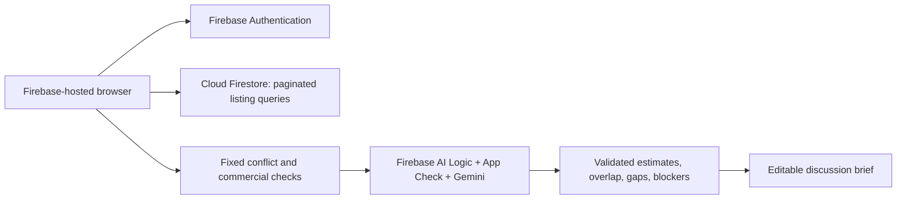

# WasteRecast global material exchange

Live entry: https://wasterecast.web.app/#exchange

## What changed

The app now combines two distinct sources of leads:

1. **Registered exchange:** buyer requirements and seller offers published by people using Firebase Authentication. Countries/regions are selected from `countries-list`. Country filtering is optional; all countries are searched by default. Each listing covers one material family; an account can publish up to ten listings for different families or requirements.
2. **Public discovery:** the existing 912 India board records and best-effort worldwide map discovery. These are not registered marketplace users or confirmed buyers. They remain in the material screening workspace.

No commercial users, offers or transactions are fabricated to populate the exchange. The matching scenario is explicitly illustrative, held in memory and never written to Firestore.

## User flow

- Select **Sell / offer waste** to find buyer requests, or **Buy raw material** to find seller offers.
- Describe the stream or requirement; choose a material family and your country. Expand specifications to state grades, exclusions, hazards, quantity, price and domestic/international preferences. Unknown quantity and price remain blank.
- Select an optional counterpart country. Search reads active, unexpired Firestore listings, and automatically semantically assesses the first eligible batch with Gemini. Load more records or assess another batch explicitly.
- A 60–79% estimated fit can be a discussion lead. Read **Specifications & discussion points**, then prepare an editable discussion brief. Contact uses only the business email the publisher explicitly consented to publish. Nothing is sent automatically.
- Register/sign in with Google or email/password to publish. Email/password users verify their email first. Google sign-in is configured; Google-account mailbox verification is provided by Firebase. Neither method verifies the business or its permits.
- **My listings** allows editing, renewal, pausing and searching for counterparts. Listings expire after 30 days. Pausing removes a listing from public searches and public direct reads; the owner can still manage it.

## Architecture and data



| Resource | Data | Access |
| --- | --- | --- |
| Firebase Authentication | Login email, credentials/provider | Managed by Firebase Authentication |
| `exchangeMembers/{uid}` | Organization, country, update timestamp | Account owner only |
| `exchangeListings/{uid}_{0..9}` | Buyer/seller role; organization; title; country/city; family; description; specs; exclusions; hazard declaration; trade scope; monthly tonnes; asking price/budget; currency; consented public business email; status; timestamps | Published records readable publicly with bounded list queries; writes require an email-verified owner and strict schema validation |
| `publicCatalog/india-v1/chunks` | Existing sourced board catalog | Public read; client writes denied |

The listing ID and integer slot are checked by rules, limiting each account to ten slots. Account IDs and emails are excluded from the **structured matching fields** sent to Gemini. Free-text listing content still reaches Gemini and can contain anything a publisher writes; users must not put confidential data there. The existing Google free-tier data terms and sampled AI logging apply.

Expired listings are excluded from search, but remain stored. A published expired record can still be directly read until its owner pauses it. Pausing is reversible and does not erase historical copies someone may have downloaded. No private chat, escrow, payment, permit verification or moderation service is claimed.

## Semantic matching methodology

1. **Retrieval:** indexed Firestore query for the opposite role, `status == published`, `expiresAt > now`, optional family and optional country. A page contains 40 records, with a cursor for the next page. Results are not an exhaustive match ranking over unloaded pages. `Other` removes the family filter.
2. **Fixed checks:** same-side listings, incompatible declared families, domestic-only cross-border trades, and a hazardous seller with a buyer that declares no hazardous acceptance are flagged. Gemini cannot override these checks.
3. **Semantic comparison:** Gemini compares meaning and synonyms (for example PP/polypropylene), material grade, proposed processing, specifications and exclusions. The inputs are treated as untrusted data; output is constrained to a structured schema and the supplied listing IDs. Maximum eight candidates per AI call.
4. **Validation:** unknown IDs and malformed scores do not create matches. Explicit incompatibilities identified by Gemini receive blockers. A blocked listing receives no tradable-fit score. Unknown hazard declarations or missing specifications cap the estimate at 74%.
5. **Ranking:** assessed records sort by descending AI estimated technical fit. The threshold can be 60%, 70%, 80% or all results including blockers. Unassessed records are labelled without invented scores. Five cards appear at a time.
6. **Negotiation:** monthly supply gaps, price gaps in the same currency, missing quotes and cross-border logistics appear separately. Different currencies are not compared. There is no inferred road distance, transport quote, live market price, regulatory approval or CO2 claim.

**The percentage is an uncalibrated model estimate of stated technical fit. It is not a probability, measured accuracy, laboratory result, buyer acceptance or certification.** A 65% result can justify a conversation; it never justifies moving waste without appropriate technical, commercial and regulatory checks. Free-text exclusions and numerical specification conflicts depend on model interpretation and require human review.

This release uses **Gemini semantic comparison/reranking, not embeddings or a vector database**. Four composite indexes support bounded queries. It avoids a paid vector service, Cloud Run and billing activation. At larger scale, embeddings, server-side retrieval, durable abuse controls and moderation would need separate implementation and evaluation. Public Spark/AI quotas can limit availability; manual listing review and the sourced screening workspace remain available when AI fails.

## Deployment and verification

Enable standard Firebase Authentication on Spark in the console; enable Email/Password and Google. Authorized domains include `wasterecast.web.app` and `wasterecast.firebaseapp.com`. Do not use the billing-required Identity Platform initialization API for this project.

```powershell
npm ci
npm test
npm run build
$env:CLOUDSDK_PYTHON = (Resolve-Path .venv/Scripts/python.exe).Path
.venv/Scripts/python.exe scripts/deploy_exchange_indexes.py
.venv/Scripts/python.exe scripts/deploy_firestore_rules.py
# Wait until all four indexes report READY before releasing search.
.venv/Scripts/python.exe scripts/deploy_spark.py
```

The public matching path reuses Firebase AI Logic with App Check; no Gemini key is added to the bundle. The local private middleware supports the same exchange schema. The existing Vercel service remains the voice-token endpoint.

Meaningful tests:

- `npm test`: listing validation; global countries; privacy of structured AI input; partial fits; score validation; hard-conflict precedence; expiry; existing app/voice tests.
- `scripts/check_exchange_live.py --run-live --sdk`: requires project-admin access; creates two clearly labelled disposable QA accounts, verifies only the QA account, then tests user-token reads/writes, denied foreign edits, unverified publication rejection, private profile isolation, ten-slot cap, and the actual Firebase SDK store. All fixtures and accounts are removed in `finally`. Never part of CI; no credentials are printed.
- `scripts/check_gemini.py --exchange`: real Gemini schema check through Firebase AI Logic; temporary App Check diagnostic credential revoked in `finally`.

The existing submission deck and three-minute video describe the earlier public-directory workflow. They do not demonstrate this new exchange. Do not present the new feature as something already shown in that recording.

Official technical references: [Firebase Google sign-in](https://firebase.google.com/docs/auth/web/google-signin), [email/password auth](https://firebase.google.com/docs/auth/web/password-auth), [Firestore field validation](https://firebase.google.com/docs/firestore/security/rules-fields), [query pagination](https://firebase.google.com/docs/firestore/query-data/query-cursors).
